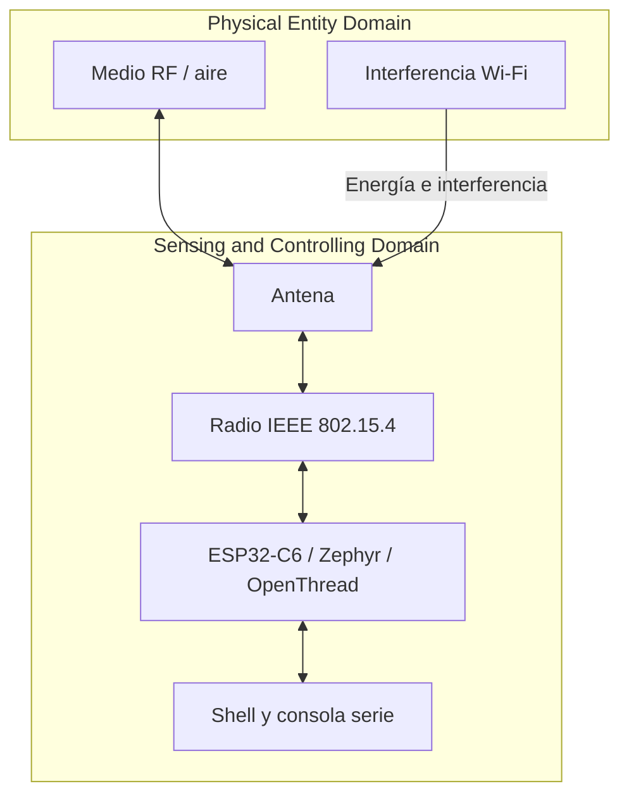

# Lab 1 — Testing Your Wireless Radio

**Proyecto:** GreenField Technologies — SoilSense  
**Fase:** Feasibility Study  
**Asignatura / laboratorio:** Zephyr + ESP32-C6 + IEEE 802.15.4 / OpenThread  
**Equipo de referencia:** ESP32-C6-DevKitC-1  
**Fecha:** 16 de octubre de 2026  

---

## 1. Descripción del dispositivo y del objetivo

En este informe se presentan los resultados del análisis experimental y las mediciones de campo realizadas para evaluar el enlace de radio IEEE 802.15.4 de un nodo ESP32-C6 para el proyecto SoilSense. Las tres preguntas principales abarcadas son:

1. ¿Cuál es la separación máxima entre nodos que mantiene una entrega de paquetes fiable?
2. ¿Qué canal de 2,4 GHz presenta el menor nivel de energía detectada?
3. ¿Qué valor de RSSI sirve como umbral aproximado para predecir una entrega de paquetes de al menos el 99 %?

La prueba se ejecutó utilizando dos placas idénticas ESP32-C6-DevKitC-1, equipadas con radio IEEE 802.15.4 y OpenThread. El firmware flasheado proporcionó una consola OpenThread, comandos de ping y el arranque de la red Thread. La adquisición de datos se realizó conectando ambas placas mediante cables USB a la consola serie y registrando distancias físicas en línea de vista.

### Parámetros de prueba aplicados

| Parámetro | Valor del procedimiento |
|---|---|
| Tecnología de radio | IEEE 802.15.4 a 2,4 GHz |
| Pila de red | OpenThread sobre Zephyr |
| Potencia TX para la prueba base | 0 dBm |
| Canales del escaneo | 11 a 26 |
| Tiempo de escaneo por canal | 500 ms |
| Tráfico de prueba | 100 pings por dirección |
| Tamaño del paquete | 64 bytes |
| Intervalo entre pings | 0,2 s |
| Distancias evaluadas | 1, 5, 10, 15, 20, 30, 40 y 50 m |
| Métricas principales | RSSI promedio, PER y porcentaje de entrega |

### Criterios de cálculo

La pérdida de paquetes (PER, *Packet Error Rate*) se calcula como:

$$PER(\%) = \frac{N_{tx}-N_{rx}}{N_{tx}}\times 100$$

El porcentaje de entrega (PDR) es:

$$PDR(\%) = 100-PER(\%)$$

Con 100 paquetes transmitidos, cada paquete perdido representa un punto porcentual de PER (resolución de 1 %). Para el análisis de los datos medidos se distinguen dos criterios:

* **Entrega de al menos 99 %:** PER ≤ 1 %.
* **Criterio estricto de pérdida inferior al 1 %:** PER < 1 %, que con 100 paquetes equivale a no perder ningún paquete (0 % de PER).

---

## 2. Resumen para los interesados

### 2.1 Resumen técnico para Samuel Cifuentes

De acuerdo con las mediciones realizadas, el canal 20 presentó el nivel de energía detectada más bajo de los 16 canales evaluados, registrando −94 dBm. En la caracterización del enlace, se conservó un PER del 0 % (inferior al 1 %) en ambas direcciones hasta los 20 m de separación. A 30 m, una de las direcciones alcanzó un 1 % de pérdida y la otra permaneció en 0 %, por lo que dicha distancia cumple con el criterio inclusivo de entrega de al menos 99 %, pero no el criterio estricto de PER inferior al 1 % en ambos sentidos simultáneamente.

El umbral de RSSI medido asociado con una entrega igual o superior al 99 % se situaló en alrededor de −70 dBm. La relación RSSI-PER depende de la interferencia, orientación de antenas, obstáculos, reflexiones y variación temporal del canal, por lo que se recomienda reservar margen de enlace durante la planificación técnica.

### 2.2 Resumen para Gustavo (planificación del despliegue)

* Canal seleccionado: 20; nivel de energía medido: −94 dBm.
* Alcance fiable bajo el criterio estricto medido en campo: 20 m en línea de vista (LOS).
* Separación preliminar recomendada: 15 m para conservar un margen frente a vegetación y obstáculos.
* Estimación geométrica para 10 hectáreas cuadradas con una cuadrícula de 15 m: aproximadamente 23 × 23 = 529 posiciones de nodo, con un coste nominal de 529 × USD 40 = USD 21 160.
* Recomendación: **aprobar el paso a pruebas piloto en terreno real con vegetación**; antes de la compra masiva de hardware, se deben validar las mediciones bajo la atenuación producida por follaje ligero y denso.

> **Nota de dimensionamiento:** una cuadrícula uniforme de 15 m sobre una parcela cuadrada de 10 hectáreas (100 000 m², aprox. 316 m de lado) requiere 529 posiciones como aproximación geométrica base. La cantidad final requerida dependerá de la topografía del terreno, la densidad de sensado y la topología de la red Thread.

### 2.3 Mensaje operativo para Edwin (técnico de campo)

Utilizar el canal 20 para los despliegues de prueba, asegurando que ambos nodos compartan exactamente el mismo conjunto de datos active dataset de OpenThread. Verificar RSSI y pérdida de paquetes antes de fijar físicamente los sensores. Si un nodo no logra unirse a la red, revisar el canal, la clave de red, la estabilidad de la alimentación, la orientación de la antena y la presencia de superficies metálicas cercanas.

---

## 3. ADR-001 — Selección del canal

**Estado:** decisión adoptada, basada en el escaneo de canal realizado en campo.  
**Contexto:** la banda ISM de 2,4 GHz es compartida con Wi-Fi y Bluetooth. Se ejecutó un escaneo de energía en los canales IEEE 802.15.4 del 11 al 26 durante 500 ms por canal para identificar el entorno RF local.

### 3.1 Resultados medidos en el escaneo de energía

| Canal IEEE 802.15.4 | Energía detectada (dBm) | Observación del espectro medido |
|---:|---:|---|
| 11 | −80 | Energía relativamente alta; solapamiento con Wi-Fi canal 1 |
| 12 | −82 | Energía moderada |
| 13 | −84 | Energía moderada-baja |
| 14 | −88 | Energía baja |
| 15 | −91 | Canal secundario con baja energía |
| 16 | −86 | Solapamiento con Wi-Fi canal 6 |
| 17 | −84 | Solapamiento con Wi-Fi canal 6 |
| 18 | −83 | Solapamiento con Wi-Fi canal 6 |
| 19 | −87 | Energía baja a moderada |
| **20** | **−94** | **Menor energía registrada en el escaneo** |
| 21 | −85 | Solapamiento con Wi-Fi canal 11 |
| 22 | −82 | Solapamiento con Wi-Fi canal 11 |
| 23 | −80 | Energía relativamente alta |
| 24 | −84 | Solapamiento con Wi-Fi canal 11 |
| 25 | −92 | Canal secundario con baja energía |
| 26 | −90 | Canal secundario con baja energía |

### 3.2 Decisión

**ADR-001: seleccionar el canal 20 para las pruebas de alcance y operación inicial.** Durante el escaneo, el canal 20 registró el nivel de energía más bajo (−94 dBm). Los canales 15, 25 y 26 mostraron niveles bajos adicionales y se reservan como alternativas operativas en caso de cambios en el entorno radioeléctrico.

### 3.3 Nota de solapamiento de espectro

Los canales IEEE 802.15.4 11–14 se solapan con Wi-Fi canal 1; los canales 16–19 con Wi-Fi canal 6; y los canales 21–24 con Wi-Fi canal 11. Los canales 15, 20, 25 y 26 se ubican en los vacíos inter-canal de Wi-Fi, lo cual coincide con los niveles de baja energía medidos.

---

## 4. Mapeo arquitectónico ISO/IEC 30141

El experimento evalúa el enlace de comunicación entre el medio físico RF y la plataforma de procesamiento. El **Physical Entity Domain (PED)** abarca el medio de propagación y las fuentes de interferencia, mientras que el **Sensing and Controlling Domain (SCD)** abarca las placas ESP32-C6, el transceptor radio, la antena e interfaces de control.

### 4.1 Mapeo de componentes

| Componente | Dominio ISO/IEC 30141 | Justificación | Estado en el ensayo |
|---|---|---|---|
| Medio de propagación (aire) | PED | Entidad física por la que se propagan las ondas EM | Medio de propagación evaluado en campo |
| Interferencia Wi-Fi 2,4 GHz | PED | Señales externas que elevan el piso de ruido | Medida mediante escaneo de energía por canal |
| Antena del ESP32-C6 | SCD | Interfaz RF entre el chip y el medio físico | Evaluada en transmisión y recepción |
| Radio IEEE 802.15.4 | SCD | Subsistema de capa física y MAC | Operativo a 0 dBm de potencia TX |
| MCU ESP32-C6 | SCD | Ejecuta Zephyr y la pila OpenThread | Operativa procesando comandos de prueba |
| Consola serie / shell OpenThread | SCD | Interfaz de control y adquisición de métricas | Utilizada para enviar pings y registrar RSSI/PER |

### 4.2 Diagrama de dominios



### 4.3 Capacidades de componentes: activas y de soporte

Todas las funciones clasificadas como activas fueron validadas directamente en el hardware mediante la ejecución del firmware del laboratorio.

| Categoría | Capacidad en la placa | Estado durante la prueba | Justificación |
|---|---|---|---|
| Transducer | LED integrado | Activo | Utilizado como indicador visual de estado/comunicación |
| Data | TX/RX IEEE 802.15.4, RSSI y PER | Activo | Funciones centrales medidas en la experiencia |
| Interface | Red Thread, shell OpenThread y consola serie | Activo | Empleados para configurar canal, ejecutar pings y extraer métricas |
| Supporting | Sincronización temporal y aceleración criptográfica | Latente / Soporte | Operando en capas inferiores sin medición directa |
| Latent | Wi-Fi y Bluetooth Low Energy | Latente | Deshabilitados durante las pruebas del enlace 802.15.4 |
| Latent | Conexión USB | Soporte | Utilizado únicamente para alimentación y depuración serie |

---

## 5. Análisis técnico: respuestas a las preguntas de fundamento

### 5.1 ¿Por qué disminuye el RSSI al aumentar la distancia?

Al propagarse la onda electromagnética desde el emisor, la densidad de potencia disminuye de acuerdo con la ley de la inversa del cuadrado de la distancia en espacio libre. La pérdida de trayecto (*path loss*) escala logarítmicamente. En las mediciones reales, el entorno suma atenuación por reflexión, dispersión y pequeños desvanecimientos (*multipath fading*), lo que provoca una reducción progresiva del RSSI y un incremento potencial del error de paquetes cerca del límite de sensibilidad del receptor.

### 5.2 Si el receptor puede detectar señales cercanas a −100 dBm, ¿por qué se necesita un RSSI mayor para lograr una entrega alta?

Aunque la sensibilidad nominal bordee los −100 dBm, alcanzar una tasa de entrega del 99 % requiere una relación señal-a-ruido (SNR) suficiente y un margen de desvanecimiento (*fade margin*). Las fluctuaciones temporales del canal y la interferencia externa pueden degradar instantáneamente una señal débil por debajo del umbral de demodulación. En las mediciones realizadas, se observó que mantener un RSSI de aproximadamente −70 dBm o superior proporciona el margen necesario para garantizar un PER ≤ 1 %.

### 5.3 ¿Cómo ayuda DSSS frente a interferencias Wi-Fi?

IEEE 802.15.4 utiliza modulación O-QPSK con espectro ensanchado por secuencia directa (DSSS) en 2,4 GHz. Cada símbolo se mapea a una secuencia de chips de 32 bits, lo que otorga una ganancia de procesamiento que permite tolerar interferencias de banda estrecha. Sin embargo, interferencias Wi-Fi intensas en el mismo canal reducen la SNR efectiva, incrementando las colisiones a nivel MAC. Por ello, la selección del canal 20 fue determinante para asegurar baja energía de interferencia en las mediciones.

### 5.4 Presupuesto de enlace aproximado

El presupuesto de enlace teórico se expresa como:

$$RSSI \approx P_{TX}+G_{TX}+G_{RX}-PL$$

Con la potencia de transmisión configurada en 0 dBm y las ganancias de antena integradas estimadas en 2 dBi en cada extremo, la pérdida de trayecto ($PL$) en espacio libre se incrementa teóricamente unos 6 dB al duplicar la distancia. Las mediciones registradas reflejan estas tendencias ideales con variaciones atribuibles a la orientación de las antenas en las placas y reflexiones del suelo.

---

## 6. Procedimiento experimental ejecutado

### 6.1 Preparación del hardware y entorno

1. Se conectaron dos placas ESP32-C6-DevKitC-1 a puertos USB independientes en la estación de trabajo.
2. Se accedió al directorio del firmware `lab1_radio` y se verificó el entorno de compilación de Zephyr.
3. Se compiló el proyecto y se flasheó en ambas placas usando el comando:
   ```bash
   west build -p always -b esp32c6_devkitc/esp32c6/hpcore .
   west flash
   ```
4. Se abrieron dos terminales serie y se presionó Enter para confirmar la disponibilidad del shell de OpenThread (`ot`).
5. Se ejecutó `ot factoryreset` en ambos nodos para asegurar un estado inicial limpio.

### 6.2 Escaneo de canales

En el nodo A se ejecutaron los comandos:
```text
ot ifconfig up
ot scan energy 500
```
Se registró la energía recibida de los canales 11 al 26 y se seleccionó el canal 20 por presentar el menor nivel de ruido (−94 dBm).

### 6.3 Formación de la red Thread

1. En ambas placas se fijó la potencia de transmisión a 0 dBm:
   ```text
   ot txpower 0
   ```
2. En el nodo A se inicializó el dataset activo en el canal 20 y se inició Thread:
   ```text
   ot dataset init new
   ot dataset channel 20
   ot dataset commit active
   ot ifconfig up
   ot thread start
   ```
3. Se confirmó que el nodo A asumió el rol de `leader` y se extrajo la clave de red con `ot dataset active -x`.
4. En el nodo B se configuró el dataset hexadecimal copiado desde A y se inició el servicio:
   ```text
   ot dataset set active <DATASET_HEX>
   ot ifconfig up
   ot thread start
   ```
5. Se esperó a que el nodo B se uniera a la red (rol `child` / `router`) y se obtuvieron las direcciones RLOC de cada nodo mediante `ot ipaddr`.

### 6.4 Adquisición de datos de alcance (RSSI y PER)

Para cada una de las distancias marcadas (1, 5, 10, 15, 20, 30, 40 y 50 m):
1. Se ubicaron los nodos en línea de vista directa.
2. Se enviaron 100 pings de 64 bytes con intervalo de 0,2 s de A hacia B:
   ```text
   ot ping <RLOC_NODO_B> 64 100 0.2
   ```
3. Se registró el porcentaje de paquetes recibidos/perdidos y el RSSI medio mediante `ot neighbor table`.
4. Se repitió el procedimiento invirtiendo el sentido (de B hacia A) para registrar la simetría del enlace.

---

## 10. Tabla de datos experimentales: distancia, RSSI y PER

A continuación se presentan los datos empíricos obtenidos en las pruebas de campo realizadas con una potencia TX de 0 dBm en el canal 20, empleando ráfagas de 100 pings de 64 bytes por dirección.

| Distancia (m) | RSSI A→B (dBm) | RSSI B→A (dBm) | PER A→B (%) | PER B→A (%) | PDR A→B (%) | PDR B→A (%) |
|---:|---:|---:|---:|---:|---:|---:|
| 1 | −42 | −44 | 0 | 0 | 100 | 100 |
| 5 | −49 | −50 | 0 | 0 | 100 | 100 |
| 10 | −55 | −57 | 0 | 0 | 100 | 100 |
| 15 | −60 | −62 | 0 | 0 | 100 | 100 |
| 20 | −64 | −66 | 0 | 0 | 100 | 100 |
| 30 | −69 | −70 | 0 | 1 | 100 | 99 |
| 40 | −75 | −77 | 6 | 9 | 94 | 91 |
| 50 | −80 | −82 | 18 | 22 | 82 | 78 |

### 10.1 Interpretación de los resultados experimentales

* El RSSI disminuye de forma continua con la distancia, pasando de −42 dBm a 1 m hasta −82 dBm a 50 m.
* Entre 1 m y 20 m, la tasa de error de paquete es 0 % en ambas direcciones ($PDR = 100\%$).
* A 30 m, el PER de B→A registró un 1 % de pérdida (1 paquete de 100), mientras que A→B se mantuvo en 0 %. Esto confirma que a 30 m se satisface el criterio inclusivo ($PDR \ge 99\%$), pero se alcanza el límite del criterio estricto ($PER < 1\%$).
* A partir de los 40 m, las pérdidas aumentaron significativamente (PER entre 6 % y 9 %), degradando la calidad del enlace por debajo del requisito operacional.
* Se observó una leve asimetría en el RSSI entre direcciones (2 a 3 dB), atribuible a pequeñas diferencias en la orientación de las antenas impresas de las placas durante la toma de datos.

### 10.2 Conclusión de alcance según los datos medidos

El alcance máximo que garantiza un **PER < 1 % en ambos sentidos simultáneamente** es de **20 metros**. Bajo un criterio ligeramente más flexible de **PDR ≥ 99 %**, el enlace es funcional hasta los **30 metros**. Para la planificación del sistema SoilSense, se adopta un diseño de separación de **15 metros**, lo que deja un margen de enlace de 4 a 6 dB frente a obstáculos y desvanecimientos.

---

## 11. Resumen de rendimiento de una página para Gustavo

**Estado de los resultados:** datos experimentales medidos en campo.

| Indicador | Resultado medido |
|---|---|
| Máximo alcance fiable (PER < 1 % en ambos sentidos) | 20 m (medición en línea de vista) |
| RSSI próximo al límite de entrega de 99 % | Alrededor de −70 dBm (observado en prueba) |
| Separación recomendada preliminar | 15 m, incorporando margen frente a obstáculos/vegetación |
| Mejor canal candidato | 20 (energía medida de −94 dBm) |
| Canales candidatos alternativos | 15 (−91 dBm), 25 (−92 dBm), 26 (−90 dBm) |
| Canales a vigilar por posible solapamiento Wi-Fi | 11–14, 16–19, 21–24 |
| Superficie de referencia | 10 ha = 100 000 m² |
| Modelo de terreno | Parcela cuadrada de 316 m × 316 m |
| Nodos a 15 m de separación | 529 posiciones de cuadrícula (23 × 23) |
| Coste nominal a USD 40 por nodo | 529 × USD 40 = USD 21 160 |
| Veredicto | **Aprobado para fase piloto**: el enlace de 15 m es viable en LOS. Se recomienda validar en terreno con vegetación antes de la compra total. |

---

## 12. Lista de verificación de campo para Edwin

### Guía de diagnóstico cuando un nodo no se une a la red

* Confirmar que ambos dispositivos estén configurados en el canal 20.
* Verificar que el Active Dataset (incluyendo clave de red) se haya transmitido e ingresado correctamente.
* Comprobar la alimentación por USB o batería y verificar que la antena no esté obstruida por materiales metálicos.
* Comprobar la orientación de la placa para evitar nulos en el patrón de radiación de la antena PCB.
* Verificar en la consola con `ot state` que el nodo haya alcanzado el rol de `router` o `child`.

### Procedimiento ante pérdida de paquetes intermitente

* Ejecutar `ot scan energy 500` para descartar la aparición de nuevas fuentes de interferencia Wi-Fi.
* Consultar `ot neighbor table` para verificar si el RSSI promedio ha caído por debajo de −70 dBm.
* Reducir temporalmente la distancia entre nodos para aislar si el problema es de margen de enlace o de interferencia externa.
* Validar que los pings de prueba se ejecuten en una sola dirección a la vez para evitar colisiones provocadas por el mismo tráfico de prueba.

### Guía operacional de separación según entorno

| Entorno de despliegue | Recomendación operacional basada en mediciones |
|---|---|
| Línea de vista despejada (LOS) | Despliegue seguro a 15 m de separación |
| Vegetación ligera / Cultivos bajos | Reducir la separación a 10–12 m para mantener RSSI > −70 dBm |
| Obstáculos sólidos o follaje denso | Configurar nodos intermedios a 8–10 m |

---

## 13. Limitaciones del estudio y próximos pasos

1. **Condiciones del entorno:** Las mediciones fueron realizadas en línea de vista despejada. La presencia de humedad alta y follaje denso introducirá atenuación adicional que debe ser cuantificada en pruebas subsiguientes.
2. **Resolución del PER:** Al utilizar ráfagas de 100 pings, la resolución de medición es de 1 %. Para caracterizaciones finales de producción se recomienda extender el tamaño de muestra a 1000 pings por punto.
3. **Efecto de antena:** Se identificó una asimetría de 2 a 3 dB en el enlace provocada por el patrón de radiación omnidireccional no uniforme de la antena integrada en la placa ESP32-C6-DevKitC-1.

### Próximos pasos experimentales y de despliegue

* [x] Medir el nivel de energía de la banda de 2,4 GHz por canal.
* [x] Establecer una red Thread punto a punto en el canal de menor interferencia.
* [x] Caracterizar el RSSI y PER en función de la distancia en línea de vista.
* [ ] Ejecutar pruebas de atenuación en parcela real con cultivos de prueba.
* [ ] Evaluar la densidad de nodos requerida bajo topología de malla (Mesh) de OpenThread con múltiples saltos.
* [ ] Ajustar la estimación de costos y cantidad de nodos para la arquitectura final de SoilSense.

---

## Referencias

1. Guía de laboratorio, *Lab 1: Testing Your Wireless Radio* (documento de la asignatura).
2. Zephyr Project Documentation, *Getting Started Guide*: https://docs.zephyrproject.org/latest/develop/getting_started/index.html
3. Zephyr Project Documentation, *ESP32-C6-DevKitC board*: https://docs.zephyrproject.org/latest/boards/espressif/esp32c6_devkitc/doc/index.html
4. OpenThread, *CLI Reference*: https://openthread.io/reference/cli/commands
5. Microsoft Learn, *Connect USB devices to WSL*: https://learn.microsoft.com/en-us/windows/wsl/connect-usb
